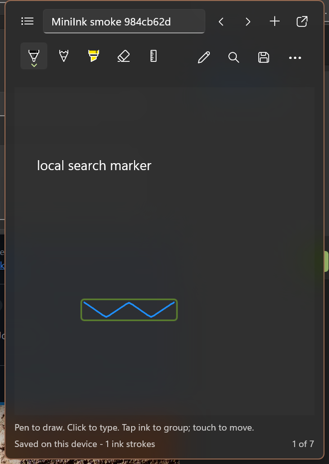
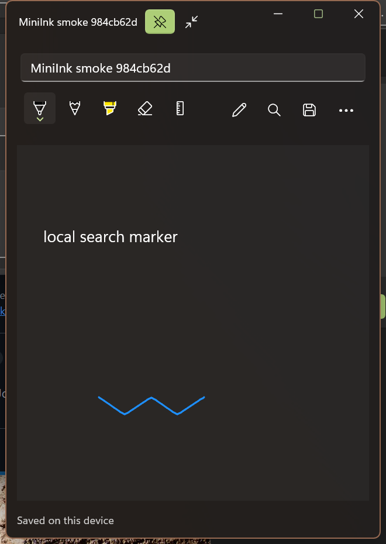

# MiniInk

Capture a thought, sketch with a pen, and find it later -- entirely in the tray.



## A pad of sticky notes in the tray

MiniInk is a packaged WinUI 3 tray app using **Windows App SDK
2.5.4-experimental**, WinUIEx, and the `winui-tray-app` lifecycle pattern.
There is no main window. The 440 by 620 logical-pixel, taskbar-anchored acrylic
popup is the pad: a blank page on top, and your notes beneath it, newest first.

Left-click the notification-area icon to toggle the popup. Right-click for
Open MiniInk, New note, New sticky note, Show sticky notes (when any are on
the desktop), or Exit MiniInk. A second launch reopens the running instance's
popup instead of adding another icon. The first launch opens on a blank page.

### Flipping through the stack

- **Older** and **Newer** (or Ctrl+Page Down and Ctrl+Page Up) flip through
  the pile; the footer shows the position, such as `3 of 12`. Newer from the
  newest note returns to the blank page. **New page** (Ctrl+N) jumps there.
- The pile's order is captured when the popup opens, so editing a note while
  flipping does not reshuffle it. The next time the popup opens, the notes you
  changed are on top. Only viewing a note does not move it.
- A blank page is not saved until something is written on it, so flipping and
  reopening never leave empty notes behind.
- **All notes** opens the searchable library. Picking a note there opens it in
  the stack.

### A fresh page after a while away

Pressing Escape or clicking away puts the popup down and saves the note.
Picking it up again quickly returns to exactly what you were doing. After it
has been put down for longer than **Open to a fresh page** (at the bottom of
the library: 1, 5 (default), 15 or 60 minutes, or Never), it opens on a blank
page instead; the previous note is waiting one step down the pile. Never
always reopens the last note.

After one minute hidden, the popup is closed and its UI, subscriptions, and
note cache are released. It is rebuilt from local storage on the next click.
Exit saves before removing the tray icon and releasing the single-instance
handles.

### Tearing off sticky notes

**Tear off** (the window button beside New page) lifts the current note off
the pad into its own window, right where the popup was, and leaves a blank page
behind. Sticky windows:

- resize freely, and their canvas grows to fill them;
- stay above other windows when **Keep on top** (the pin) is on;
- leave the stack while they are on the desktop. The library marks them
  "on your desktop", and picking one there brings its window forward;
- go back into the stack when closed. **Put back in the stack** also closes
  the window and opens the note in the popup;
- come back where they were, pinned or not, the next time MiniInk starts,
  without taking focus. Positions are pulled back on screen if a monitor is
  gone. A sticky that was never written on is not brought back.

New sticky note in the tray menu opens a blank sticky window directly.



## Pen, text, and touch

- **Only pen input draws.** Choose a pen, pencil, highlighter, or eraser in the
  native ink toolbar. The initial pen color is blue for contrast in both themes.
- **Click empty space to type.** Click existing text to edit it, or use Add text
  in the toolbar. Text stays where it was placed.
- **Touch moves objects, not ink input.** Drag text with a finger. Tap ink to
  analyze it and select a recognized word, drawing, or individual unrecognized
  stroke; then drag the selected group with touch or mouse.
- The arrow keys nudge selected objects when a text field is not focused.
  Escape clears a selection first, then puts the popup down.
  Delete selected object is in the overflow menu, with confirmation.
- Autosave runs after a short idle interval, never during a pen stroke or
  object drag. Save and Ctrl+S also save immediately.

The canvas fills the popup or sticky window, with a 400 by 400 logical-pixel
minimum. It grows to keep anything placed further out, such as ink drawn in a
large sticky window, so smaller windows show that content with scrollbars.
Touch remains reserved for object manipulation.
The popup follows the **taskbar's** light/dark mode, including theme-specific
tray icons generated from the supplied `icon.svg`.

## Local handwriting search

Title, typed text, recognized handwriting, and recognition alternatives are
indexed locally. Every whitespace-separated search term must match the note.
Original ink is preserved as ISF, not converted into text or replaced by
recognition results.

Windows handwriting language support must be installed for reliable
recognition. Accuracy varies with handwriting, language, and drawing style;
it is not guaranteed for every word. Ink is saved **before** analysis, so a
recognition failure cannot prevent note saving. Errors are shown in the
popup; Analyze ink retries.

Each note is an atomically replaced JSON file under the package's
`LocalState\Notes` folder, containing text positions, ISF ink encoded as
Base64, and handwriting search terms. Unreadable files are reported without
being overwritten. Sticky window positions, sizes, and pins are kept in
`LocalState\StickyNotes.json`; if that file is unreadable, MiniInk starts with
no sticky windows. Crash diagnostics are written to `%TEMP%\MiniInk-crash.log`.
There are no accounts, API keys, network calls, or cloud uploads. Idle memory
is released once the popup and every sticky window have closed; no network
polling runs while hidden.

## Build and run

Requirements: Windows 10/11 with the supported Windows App SDK runtime,
.NET 10 SDK, Windows SDK, Developer Mode, and WinApp CLI 0.7+. The project
supports x64 and ARM64. This is an experimental SDK application; the inking
APIs may change or be removed in future releases.

```powershell
winget install Microsoft.WinAppCli
winapp run .\MiniInk\MiniInk.csproj --detach
```

No signed release installer is included yet. The CLI registers a development
package locally; it is not a Microsoft Store installation.

```powershell
# Pure search, stack order, fresh-page timing, sticky layout, storage, and corruption checks
dotnet run --project .\MiniInk.Tests\MiniInk.Tests.csproj

# Local UI smoke checks (unlocked desktop; creates a uniquely named test note)
.\scripts\Test-Ui.ps1

# Regenerate the package assets and the two tray icons
.\scripts\Generate-Assets.ps1
```

UI tests create screenshots and a structured results report. Screen capture
is used because window-only capture does not faithfully render layered acrylic.
Test notes have titles beginning with `MiniInk smoke`.
